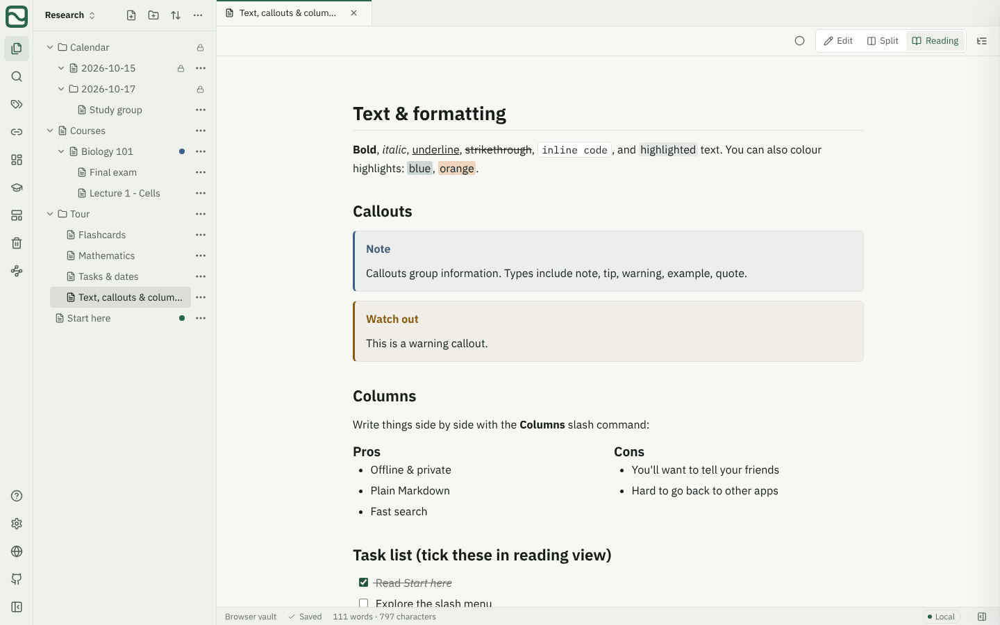
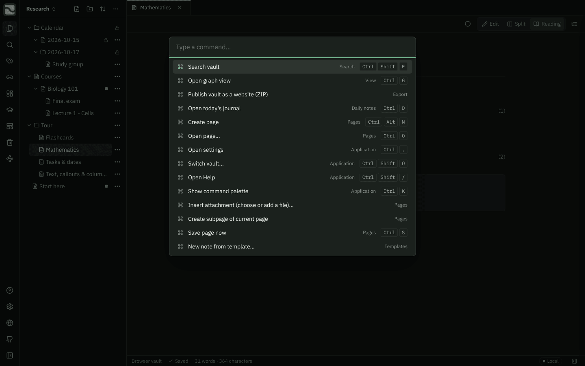
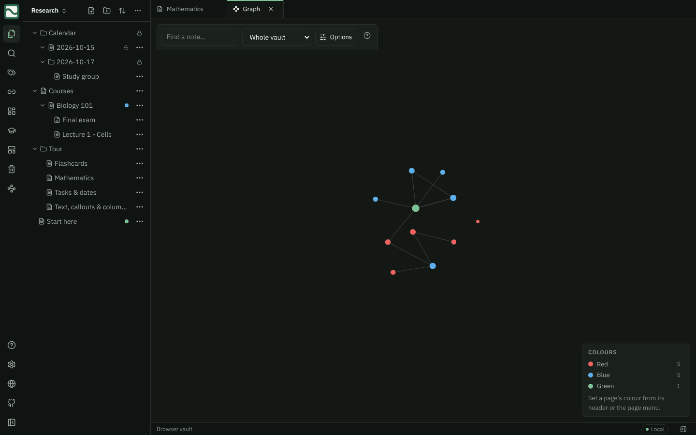

<div align="center">


### Your notes should outlive the app.

An open-source, local-first research journal and linked-note app built on plain Markdown.<br />
Work offline, link ideas, search everything and keep your files yours.

[Open Neoma](https://www.neomadev.app/app/) · [Website](https://www.neomadev.app) · [Docs](https://www.neomadev.app/docs/) · [Download](https://www.neomadev.app/download)

[](LICENSE)
[](https://github.com/infinitumio/neoma/actions/workflows/build.yml)
[](https://github.com/infinitumio/neoma/actions/workflows/test.yml)
[](CONTRIBUTING.md)



</div>

## What Neoma is

- **Plain Markdown.** A vault is a folder of `.md` files. Links, tags, properties and
  citations are ordinary text that any editor can read. Frontmatter you add is never deleted.
- **Local-first.** No account, no cloud, no telemetry. Your notes live in this browser or in a
  folder you choose, and nothing is uploaded.
- **Offline.** After the first load everything works without a connection.
- **Linked.** `[[Wiki links]]`, backlinks, unlinked mentions, embeds and a graph. Rename a note
  and Neoma shows every link it will update before changing anything.
- **For research.** An offline PDF viewer with page links and split view, `[@citation]` keys,
  KaTeX maths, theorem and proof blocks, daily notes, tasks, flashcards and a study dashboard.
- **Keyboard-first.** `Ctrl/Cmd+K` for every command; `/` for every block.
- **Open source.** This repository is the web edition, under the AGPL. Read it, run it,
  self-host it, change it.

<table>
<tr>
<td width="50%"></td>
<td width="50%"></td>
</tr>
<tr>
<td align="center"><sub>The command palette</sub></td>
<td align="center"><sub>The graph</sub></td>
</tr>
</table>

## Run it

The quickest way is the hosted web app at **[neomadev.app/app](https://www.neomadev.app/app/)**.
To run this repository yourself you need [Node.js 20+](https://nodejs.org/):

```bash
git clone https://github.com/infinitumio/neoma.git
cd neoma
npm ci
npm run dev          # http://localhost:5173
```

Or run `./start.sh` (macOS, Linux) or `start.bat` (Windows), which installs, builds and opens
it for you. To install it as an app, use your browser's _Install_ action.

### Self-host

Neoma has no backend: self-hosting means serving files. Notes stay in each visitor's browser
or chosen folder, never on your server.

```bash
docker compose up -d          # http://localhost:8080
# or: npm run build, then serve dist/ from any static host
```

Serve it over HTTPS: browsers only allow offline mode and folder vaults on secure origins.
More in the [self-hosting docs](https://www.neomadev.app/docs/self-hosting).

## Develop

```bash
npm run typecheck    # TypeScript
npm run lint         # ESLint
npm test             # unit tests (Vitest)
npm run test:e2e     # end-to-end tests (Playwright)
npm run build        # production build in dist/
```

Start with [CONTRIBUTING.md](CONTRIBUTING.md) and [docs/architecture.md](docs/architecture.md).
The short version: the interface talks to storage only through `StorageAdapter`
(`src/storage/`), search and metadata run in a Web Worker (`src/workers/`), and commands,
panels, Markdown extensions and settings register through registries the way a future plugin
would.

## Storage, privacy, compatibility

|                   |                                                                                                                                                             |
| ----------------- | ----------------------------------------------------------------------------------------------------------------------------------------------------------- |
| **Browser vault** | IndexedDB in this browser. Zero setup. Export a ZIP now and then: clearing site data deletes it.                                                            |
| **Folder vault**  | Real `.md` files in a folder you pick (Chromium browsers). Works with Git and sync tools.                                                                   |
| **Privacy**       | No accounts, analytics, telemetry, ads, CDN assets or remote AI. Remote images are blocked until you allow them. [docs/privacy.md](docs/privacy.md)         |
| **Markdown**      | CommonMark and GFM, plus wiki links, `==highlights==`, callouts, maths and `[@citations]`. [docs/markdown-compatibility.md](docs/markdown-compatibility.md) |

## Licence and editions

**[AGPL-3.0-or-later](LICENSE).** You can run, study, share, self-host and modify this edition.
If you run a modified version as a network service, offer its users your source.

The desktop installers and App Store builds are the same application, packaged from a
separate, private repository under a proprietary licence, because the App Store's terms are
incompatible with the AGPL. This edition is not a demo, and it stays AGPL. The details, and
what it means for contributions, are on
[neomadev.app/open-source](https://www.neomadev.app/open-source) and in
[CONTRIBUTING.md](CONTRIBUTING.md).

The Neoma name and logo are not covered by the licence; see
[brand/README.md](brand/README.md).

## Roadmap

Real status, no dates: [ROADMAP.md](ROADMAP.md).

## Creator

Neoma is made by **Iwan** as an independent project for researchers, students, developers
and anyone who wants to own their notes. It is not affiliated with any other notes app.
